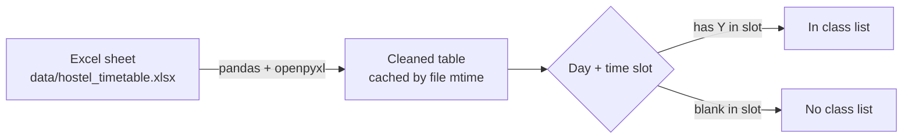

# ClassTrack
A college class tracker

<div align="center">

# 🏠 ClassTrack

**A college class tracker for hostel wardens.**
Pick a day and a time slot, and instantly see who has class and who doesn't, so you only check the rooms that matter.


[**Live demo**](https://your-app-name.streamlit.app) · [Report a bug](../../issues)

<!-- Add a screenshot: save it as docs/screenshot.png, then uncomment the line below -->
<!--  -->

</div>

---

## The problem

Hostels in Delhi University colleges house students from many courses and years. Almost every student has a **different timetable**, because of electives, practicals and combinations of subjects. When a hostel rule asks the warden to report students who stay back during class hours, checking every room is slow, and working out who *should* be in class right now is guesswork.

## The solution

ClassTrack turns one Excel sheet into a simple mobile-friendly app.

1. Each student's timetable is entered once, as a **Y** in each slot where they have class.
2. The warden opens the app, picks the day and time (it opens on the **current** day and slot by default).
3. The app shows two lists:
   - **In class**: students who should be in class right now. These are the rooms to check.
   - **No class**: students who are free, so there is nothing to check.

No more asking every student about their schedule, and no timetable images to decode.

## Features

- 📅 **Day and time selector** for Mon to Fri, with 8 hourly slots (lunch break included)
- ⏱️ **Auto-selects the current day and slot** in Indian time, and opens on Monday at weekends
- 👥 **In class / No class lists** with live counts, sorted by room number
- 🔎 **Search** by name, room or course, and filter by **year**
- 📊 **Excel is the database**: edit the sheet, and the app updates when the file changes
- 🛡️ **Friendly error messages** if the Excel file is missing a required column
- 📱 **Works on a phone**, which is where wardens will actually use it

## How it works



The app reads the Excel file, cleans it (trims spaces, treats `y` and `Y` the same, ignores blank rows) and caches the result. The cache is tied to the file's modified time, so changing the file refreshes the data automatically.

## Time slots

| Slot | 1 | 2 | 3 | 4 | | 5 | 6 | 7 | 8 |
|---|---|---|---|---|---|---|---|---|---|
| **Start** | 8:30 | 9:30 | 10:30 | 11:30 | *lunch 12:30 to 1:00* | 1:00 | 2:00 | 3:00 | 4:00 |

Each class is one hour, and college runs from 8:30 am to 5:00 pm.

## Excel format

The data lives in `data/hostel_timetable.xlsx`, on the **Timetable** sheet, with one row per student.

| Name | Room | Year | Course | Mon-1 | Mon-2 | … | Fri-8 |
|---|---|---|---|---|---|---|---|
| Asha | 12 | 2 | BA Hons English | Y | Y | | |

- Type **Y** in every slot where the student has class, and leave free slots blank.
- Keep the header row exactly as it is: `Name, Room, Year, Course, Mon-1 … Fri-8`.
- Slot columns are named `Day-SlotNumber` (for example `Wed-5` means Wednesday, 1:00 pm).

## Quick start

```bash
git clone https://github.com/<your-username>/<your-repo>.git
cd <your-repo>
pip install -r requirements.txt
streamlit run app.py
```

Then open the local address Streamlit prints in the terminal (usually http://localhost:8501).

## Deploy for free on Streamlit Community Cloud

1. Push this repository to GitHub.
2. Go to [share.streamlit.io](https://share.streamlit.io) and click **New app**.
3. Select your repository, branch `main`, and main file path `app.py`.
4. Click **Deploy**, and share the link with the warden.

## Updating students

1. Edit `data/hostel_timetable.xlsx` to add, remove or change students.
2. Replace the file in the GitHub repo with the same name and path.
3. The app picks up the change after the redeploy. If it doesn't, open the app menu and choose **Reboot**.

## Project structure

```
ClassTrack/
├── app.py                      # Streamlit app (UI + logic)
├── requirements.txt            # streamlit, pandas, openpyxl
├── data/
│   └── hostel_timetable.xlsx   # student timetable data
└── README.md
```

## Tech stack

- **Python** and **Streamlit** for the interface
- **pandas** for filtering and sorting
- **openpyxl** for reading Excel files

## A note on privacy

The Excel file contains student names, room numbers and class timings, and the app has no login. If you publish this repository, **use dummy data in the public repo** (or keep the repo private) and restrict who can open the deployed app in Streamlit's sharing settings.

## Roadmap

Ideas for future versions (not built yet):

- [ ] Mark classes as cancelled for a day, so those students drop out of the "In class" list
- [ ] Approved leave and sick-student list
- [ ] Shared check marks for several wardens
- [ ] One-click daily report for the professor
- [ ] Password protection

## Contributing

Suggestions and pull requests are welcome. Open an issue to discuss what you'd like to change.

---

<div align="center">
Built to make a warden's round a little easier. ⭐ Star the repo if it helped you.
</div>
